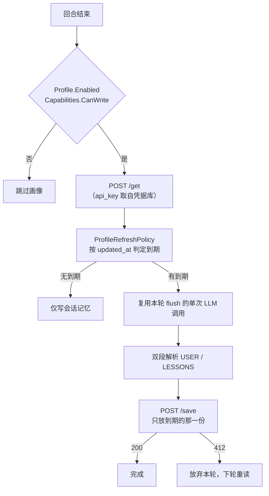

# 远端习惯画像服务接口规范

本文档定义「账户级习惯画像」（`USER.md` / `LESSONS.md`）切换到远端存储时，服务端必须提供的接口，以及客户端依赖的语义契约。

**两个设计前提**：

1. **认证**：调用方在请求体中输入 `api_key`，服务端据此解析出**当前用户**，只返回并只允许修改该用户自己的记忆。不使用 `Authorization` 头，也不接受任何 `account_id` / `user_id` 作为身份来源。
2. **组合载荷**：不使用 `{kind}` 路径参数。两份文档一次性以 JSON 对象组合返回与提交，键名即文档名。

适用范围：`Athlon.Agent.Core.Memory.IProfileMemory` 的远端实现（`RemoteProfileMemory`）。本地文件实现（`LocalFileProfileMemory`）已上线，本规范不改变其行为。

---

## 1. 背景

习惯画像是**账户级**长期记忆，跨工作区、跨会话共享，只记两类内容：

| 文档 | JSON 键 | 文件名 | 内容 | 默认字符上限 |
|---|---|---|---|---|
| 用户习惯 | `user` | `USER.md` | 称呼、语言、语气、输出格式偏好、反复出现的工作习惯 | 3000 |
| 纠正教训 | `lessons` | `LESSONS.md` | 「失败 → 用户纠正 → 重试成功」提炼出的可复用规则 | 2500 |

写入时机与频率由客户端的到期判定决定（见第 3 节），服务端不需要理解该策略，只需提供**权威的修改时间**与**乐观并发控制**。

---

## 2. 接口清单

基础路径：`{BaseUrl}/agent/profile`（与 `BehaviorReport` 的 `{BaseUrl}/agent/report` 同级）

| # | 方法 | 路径 | 用途 | 必需 |
|---|---|---|---|---|
| 1 | `POST` | `/agent/profile/get` | 一次返回当前用户的两份记忆（组合 JSON） | 是 |
| 2 | `POST` | `/agent/profile/save` | 提交若干份文档（键名即文档，缺省不动） | 是 |
| 3 | `POST` | `/agent/profile/clear` | 清除指定文档 | 是 |
| 4 | `POST` | `/agent/profile/revisions` | 两份文档的修改历史（审计） | 可选 |

三个必需接口都只接受一个请求体，**没有路径参数**。文档的定位完全由 JSON 键表达。

---

## 3. 客户端如何使用这些接口



关键点：

- **一次 `get` 拿全两份**，每回合只有 1 次读取往返（原来是 2 次）。
- **`save` 只提交到期的那份**，未提交的键服务端一律不动——不需要传全文来"保留"另一份。
- **到期判定完全在客户端**，依据是 `updated_at` 与本地时钟；服务端不参与、也无需感知。
- **写入是整文档替换**，没有 append / patch 语义。

---

## 4. 接口详情

### 4.0 通用约定

**认证：请求体中的 `api_key`**

| 字段 | 类型 | 必需 | 说明 |
|---|---|---|---|
| `api_key` | string | 是 | 调用方持有的密钥。服务端计算 `SHA-256(api_key)` 得到 `account_hash`，用它当作用户唯一标识 |

约定：

- `api_key` **是唯一的身份来源**。服务端不得信任请求中的任何其他身份字段；即便客户端多传了 `account_id` / `user_id` / `email`，也必须忽略。
- 所有接口都是 `POST`（凭据在 body 里），路径使用明确的动作名，不使用 `GET`-with-body。
- `api_key` 无效、被吊销或过期时统一返回 `401 unauthorized`，**不要**区分「不存在」与「已验证但无权」，避免探测。
- 服务端**必须**在访问日志中脱敏 `api_key`（只记录前 6 位 + `***`），响应体永不回显。
- 强制 TLS；不接受明文 HTTP。

**编码**：请求与响应均为 `application/json; charset=utf-8`。`content` 是 UTF-8 Markdown 纯文本，服务端**必须按不透明字符串存取**，不得解析、重排或重新序列化。

**时间格式**：ISO 8601 UTC，毫秒精度，`Z` 后缀。

```
2026-11-04T01:30:00.000Z
```

**文档对象（Document）**

`get`、`save`、`clear`、`revisions` 共用同一个形状：

```json
{
  "content": "# USER\n\n## 交流风格\n- 用中文回答\n",
  "revision": "e7c1f0a9",
  "updated_at": "2026-11-04T01:30:00.000Z",
  "writable": true,
  "updated_by": "device-9f2c",
  "size_bytes": 78
}
```

| 字段 | 类型 | 读时必需 | 说明 |
|---|---|---|---|
| `content` | string | 是 | 文档全文 |
| `revision` | string | 是 | 单调递增的版本标识（不透明字符串）。用于 `save` 的乐观锁 |
| `updated_at` | string | 是 | **服务端权威**的最后修改时间，跨设备共享。绝不能取自客户端 |
| `writable` | boolean | 否 | 该文档是否允许客户端写入。缺省视为 `true` |
| `updated_by` | string | 否 | 最后写入的设备标识，便于排查覆盖问题 |
| `size_bytes` | integer | 否 | `content` 的 UTF-8 字节数 |

**通用错误响应**

```json
{
  "error": {
    "code": "profile_too_large",
    "message": "lessons.content exceeds 65536 bytes",
    "field": "lessons"
  }
}
```

**通用状态码**

| 状态 | 含义 |
|---|---|
| `200` | 成功 |
| `400` | 请求体不合法（缺 `api_key`、键名未知、JSON 解析失败） |
| `401` | `api_key` 无效 / 已吊销 |
| `403` | 目标文档只读（见 4.5） |
| `409` | 提交了已知但不可写的键 |
| `412` | 某份文档的 `expected_revision` 不符 |
| `413` | 某份文档超过服务端上限 |
| `429` | 限流，带 `Retry-After` |
| `5xx` | 服务端故障 |

---

### 4.1 `POST /agent/profile/get` — 读取当前用户的全部记忆

**请求体**

```json
{ "api_key": "sk-live-9f2c..." }
```

**成功响应 `200`**

```json
{
  "user": {
    "content": "# USER\n\n## 交流风格\n- 用中文回答\n- 代码块标注语言\n",
    "revision": "e7c1f0a9",
    "updated_at": "2026-11-04T01:30:00.000Z",
    "writable": true,
    "updated_by": "device-9f2c",
    "size_bytes": 78
  },
  "lessons": null,
  "server_now": "2026-11-04T01:35:12.345Z"
}
```

| 字段 | 类型 | 必需 | 说明 |
|---|---|---|---|
| `user` | Document \| null | 是 | 用户习惯。`null` 表示从未写过 |
| `lessons` | Document \| null | 是 | 纠正教训。`null` 表示从未写过 |
| `server_now` | string | 是 | 服务端当前时间。客户端用它换算时钟偏移（见 5.2） |

要点：

- **两个键必须始终存在**，未写过的用 `null`，不要省略。客户端靠键的存在区分「结构完整的空画像」与「服务端返回不完整」。
- **不存在单份 `404`**：新用户一次成功 `200` 拿到 `{ "user": null, "lessons": null }`。这也顺带消除了「`404` 是首次写入还是出错」的歧义——只要不是 `200`，就按不可用处理（见 5.3）。
- 未来若增加文档类型（例如 `style`），只加键，不改接口。

---

### 4.2 `POST /agent/profile/save` — 提交文档

**请求体**

```json
{
  "api_key": "sk-live-9f2c...",
  "user": {
    "content": "# USER\n\n## 交流风格\n- 用中文回答\n",
    "expected_revision": "e7c1f0a9"
  },
  "device_id": "device-9f2c",
  "client_sent_at": "2026-11-04T01:35:10.000Z"
}
```

| 字段 | 类型 | 必需 | 说明 |
|---|---|---|---|
| `api_key` | string | 是 | 决定改哪个用户 |
| `user` | DocumentInput | 否 | 提交即覆盖；**不出现则不动** |
| `lessons` | DocumentInput | 否 | 同上 |
| `device_id` | string | 否 | 设备标识，写入 `updated_by` |
| `client_sent_at` | string | 否 | 客户端生成时间，**仅用于审计**，不得写入 `updated_at` |

`DocumentInput`：

| 字段 | 类型 | 必需 | 说明 |
|---|---|---|---|
| `content` | string | 是 | 完整文档。允许空字符串 |
| `expected_revision` | string \| null | 否 | 上次 `get` 拿到的 `revision`；`null` 或省略表示「期望当前不存在」 |

**语义（重要）**

- **键缺省 = 不修改**。客户端本轮只写了 `USER`，就只传 `user`，`lessons` 保持原样，不需要先读出来再回写。
- **`user` 和 `lessons` 可以同时出现**，此时按**单事务原子提交**：任一文档的 `expected_revision` 不符，整包不写入并返回 `412`。
- 两份都不出现等价于空操作，返回 `200` 且 `updated_at` / `revision` 不变。

**成功响应 `200`**

只回新版本，不回 `content`（客户端不缓存返回值，下一轮以 `get` 为准）：

```json
{
  "user": {
    "revision": "f1a2b3c4",
    "updated_at": "2026-11-04T01:35:11.204Z",
    "size_bytes": 34
  },
  "server_now": "2026-11-04T01:35:11.205Z"
}
```

`lessons` 未提交，所以响应里没有该键。

**`412 Precondition Failed`**

```json
{
  "error": {
    "code": "revision_conflict",
    "message": "lessons was modified by another device",
    "field": "lessons",
    "current_revision": "e7c1f0a9",
    "current_updated_at": "2026-11-04T01:30:00.000Z"
  }
}
```

客户端收到 `412` 后**放弃本轮写入**，不重试、不强推；下一轮 `get` 会拿到新内容后重新判定。

**`403 Forbidden`**：目标文档只读（见 4.5）。
**`413 Payload Too Large`**：某份 `content` 超过服务端上限（建议 64 KiB，远大于客户端 3000/2500 字符预算），`field` 指明是哪份。

---

### 4.3 `POST /agent/profile/clear` — 清除

**请求体**

```json
{
  "api_key": "sk-live-9f2c...",
  "user": { "expected_revision": "e7c1f0a9" }
}
```

也可以一次清两份：

```json
{
  "api_key": "sk-live-9f2c...",
  "user": { "expected_revision": "e7c1f0a9" },
  "lessons": { "expected_revision": null }
}
```

**语义**

- 键出现即删除该文档；`expected_revision` 可选，用于避免误删刚被其他设备更新的内容。
- 删除不存在的文档视为成功（幂等），不返回 `404`。
- 删除后再次 `get`，该键为 `null`；`revision` 不得复用。

**响应**

| 状态 | 含义 |
|---|---|
| `200` | 返回实际被删除的键 |
| `412` | 某份 `expected_revision` 冲突，整包未删除 |

```json
{ "cleared": ["user"], "server_now": "2026-11-04T01:40:00.000Z" }
```

---

### 4.4 `POST /agent/profile/revisions` — 修改历史（可选）

**请求体**

```json
{ "api_key": "sk-live-9f2c...", "limit": 20 }
```

**响应 `200`**

```json
{
  "user": [
    { "revision": "f1a2b3c4", "updated_at": "2026-11-04T01:35:11.204Z",
      "updated_by": "device-9f2c", "size_bytes": 34 }
  ],
  "lessons": []
}
```

只返回元数据，**不返回历史正文**，避免扩散个人信息。

---

### 4.5 只读账户

若某些用户的画像由组织统一托管（运维下发、客户端只读），服务端需要让客户端提前知道，否则每次冷却到期都会白烧一次模型输出。

推荐做法：在 `get` 响应对应文档里返回 `"writable": false`。客户端据此把该文档排除在到期集合之外，既不请求模型，也不发 `save`。

兜底做法：`save` / `clear` 恒返回 `403`。客户端可按此降级为只读，但会先浪费一次模型输出——所以优先用 `writable` 提前声明。

---

## 5. 客户端依赖的语义契约

以下五条是客户端正确性所必需的，缺任何一条都会导致可观察的故障。

### 5.1 `updated_at` 必须是服务端权威时间

客户端用它判断「USER 是否满 2 小时未刷新」以及「是否有比文档更新的纠正」。若服务端保存客户端传来的 `client_sent_at`，一台时钟不准的设备就会污染全账户的刷新节奏。

### 5.2 `server_now` 用于时钟域换算

`LESSONS.md` 的判定是**跨时钟比较**：本地纠错消息的 `CreatedAt` vs 服务端的 `updated_at`。服务端时间快 1 小时，用户 5 分钟前的纠正就会看起来「比文档旧」，信号被永久吞掉。

客户端换算方式（接远端时在 `RemoteProfileMemory` 内完成）：

```csharp
// offset = 本地时钟 - 服务端时钟
var offset = DateTimeOffset.UtcNow - serverNow;
var anchorLocal = updatedAt + offset;
if (anchorLocal > now)
{
    anchorLocal = now;   // 服务端时间偏快时收敛，避免永不到期
}
```

若 `server_now` 缺失，客户端可退回使用响应的 HTTP `Date` 头；两者都没有时按 `updated_at` 原值使用，并在日志中告警。

### 5.3 只有 `200` 才代表「读到了」

因为 `get` 用键级 `null` 表达「从未写过」，客户端不需要靠 `404` 推断首次写入。这条简化了错误处理：

| 结果 | 客户端语义 | 行为 |
|---|---|---|
| `200` | `Ok` | 键为 `null` 的文档视为从未写入，立即到期 |
| `401` / `403` / `429` / `5xx` / 超时 / 连接失败 | `Unavailable` | **本轮跳过画像**，不写入、不推进冷却 |

这一点必须严格遵守。若把失败也当成「从未写入」：

1. 每轮都判定 `USER` 到期 → 每轮都让模型重写全文（成本放大 10~20 倍）；
2. prompt 里写「当前文档为空，写第一版」→ 网络恢复后可能覆盖远端真实内容。

`api_key` 无效返回 `401` 同样属于 `Unavailable`——客户端本轮不写，等用户修好凭据。

### 5.4 `revision` 与 `expected_revision` 是防止跨设备覆盖的唯一手段

时间戳无法解决这个：设备 A 拿着 20 分钟前读到的内容重写，会覆盖设备 B 刚写的新版。服务端必须在 `save` 时逐份校验 `expected_revision`，不匹配返回 `412`。

### 5.5 `api_key` 必须逐次校验，不得缓存为「已登录」

因为凭据在 body 里，服务端每次请求都要重新解析 `api_key` → `account_hash`。不做会话、不发 token，也就不存在「退出登录后旧 token 仍有效」的问题。密钥吊销后下一次请求立即 `401`。

---

## 6. 调用量与限流

| 场景 | 频次 |
|---|---|
| `get` | 每次 flush 前 1 次（组合返回，无论几份文档） |
| `save` | 仅到期时：`USER` 最多每 `UserRefreshCooldown`（默认 2 小时）一次；`LESSONS` 仅在有新纠错时一次 |
| `clear` | 仅用户手动清除 |

按每日 100 回合的重度用户估算：约 100 次 `get` + 个位数 `save`。

建议：

- 服务端限流返回 `429` 时带 `Retry-After`（秒），客户端按该值退避；
- 客户端侧另有一层 `CachedProfileMemory` 装饰器（建议 TTL 60 秒），进一步压低 `get` 量；
- 若未来需要条件读取，可在 `get` 请求加 `known_revision`，内容未变时返回 `{"unchanged": true}`，避免引入新的 HTTP 头。

**超时建议**：连接 5 秒 / 总计 10 秒。画像不是关键路径，超时即按 `Unavailable` 处理。

---

## 7. 服务端存储建议

最小可行表结构：

```sql
CREATE TABLE agent_profile_document (
  account_hash    CHAR(64)     NOT NULL,          -- SHA-256(api_key)，主键一部分
  kind            VARCHAR(16)  NOT NULL,          -- 'user' | 'lessons'
  content         MEDIUMTEXT   NOT NULL,          -- 原样存取，不做格式校验
  revision        BIGINT       NOT NULL,          -- 每次写入 +1，对外转字符串
  writable        TINYINT(1)   NOT NULL DEFAULT 1,
  updated_at_ms   BIGINT       NOT NULL,          -- 服务端时间
  updated_by      VARCHAR(64)  NULL,
  updated_from_ip VARCHAR(45)  NULL,
  created_at_ms   BIGINT       NOT NULL,
  PRIMARY KEY (account_hash, kind)
);
```

要点：

- 表里仍按行存（一行一份文档），但**接口层组合成一份 JSON**。这样并发控制可以精确到文档，而客户端只面对一个键。
- `account_hash` = `SHA-256(api_key)`，**不落明文 Key**；`api_key` 只作为输入参数存在，不持久化。
- `revision` 用自增整数最省事，对外序列化成字符串，客户端按不透明值对待。
- 写入用 `UPDATE ... WHERE account_hash=? AND kind=? AND revision=?`，影响行数为 0 即返回 `412`，天然免锁。
- 首次写入用 `INSERT`，主键冲突同样映射为 `412`。
- 同时提交两份时开事务：任一 `UPDATE` 影响行数为 0 就整体回滚。

---

## 8. 安全与合规

画像内容是**个人信息**（称谓、语言偏好、工作习惯、踩坑记录），按 PII 对待。由于 `api_key` 出现在请求体中，额外注意：

- 强制 TLS；不接受明文 HTTP
- 反向代理与应用日志**必须**脱敏 `api_key`（只留前 6 位），且不得记录 `content` 正文
- 不把 `api_key` 写入报错信息、堆栈或监控埋点
- 数据库字段加密（静态加密）或至少磁盘级加密
- 账户注销时随账户一并物理删除
- 提供 `clear` 以便用户在设置页自助清除
- 不与其他账户共享缓存键；若做边缘缓存，缓存键必须含 `account_hash`

---

## 9. 客户端适配点

接远端时需要改动的客户端位置（当前均已就位，只需新增一个实现）：

| 文件 | 改动 |
|---|---|
| [IProfileMemory.cs](../../src/Athlon.Agent.Core/Memory/IProfileMemory.cs) | 增加三态读取结果（`ProfileReadStatus` + `server_now`）、`revision`、`writable` |
| [ProfileMemoryFactory.cs](../../src/Athlon.Agent.Infrastructure/Memory/ProfileMemoryFactory.cs) | `ProfileBackendKind.Remote` 分支改为构造 `RemoteProfileMemory`（当前回退本地） |
| 新增 `RemoteProfileMemory` | 实现三个 `POST` 接口 + 时钟换算 + 三态映射 + 从凭据库读取 `api_key` |
| 建议新增 `CachedProfileMemory` | 装饰器：读穿透缓存 + 写回烘 |
| [ProfileRefreshPolicy.cs](../../src/Athlon.Agent.Core/Memory/ProfileRefreshPolicy.cs) | **无需改动**（已做到后端无关） |
| [MemoryFlushService.cs](../../src/Athlon.Agent.Infrastructure/Memory/MemoryFlushService.cs) | `ResolveProfileWorkAsync` 需按 `Capabilities.CanWrite` / `writable` 过滤到期文档；`Unavailable` 时本轮不刷新 |
| [ProfileGetTool.cs](../../src/Athlon.Agent.Infrastructure/Memory/ProfileGetTool.cs) | 无需改动 |
| 设置页 | 后端下拉启用 `Remote` 项，展示 API Key 是否已配置、服务端可达性与最后同步时间 |

### 远端实现骨架

```csharp
public sealed class RemoteProfileMemory(
    HttpClient http,
    ICredentialStore credentials,
    AppSettings settings) : IProfileMemory
{
    public ProfileCapabilities Capabilities => new(ProfileBackendKind.Remote, true, true, IsRemote: true);

    public async Task<ProfileReadResult> ReadAsync(ProfileKind kind, CancellationToken ct)
    {
        // 凭据缺失就是「暂时不可用」，绝不能当作「从未写入」。
        var apiKey = await credentials.GetSecretAsync(ModelSettings.ApiKeySecretName, ct);
        if (string.IsNullOrWhiteSpace(apiKey))
        {
            return ProfileReadResult.Unavailable();
        }

        using var response = await http.PostAsJsonAsync(
            settings.Profile.GetUrl,           // {BaseUrl}/agent/profile/get
            new { api_key = apiKey },
            ct);

        // 只有 200 才算读到；其余一律不可用，键级 null 才是「从未写入」。
        if (response.StatusCode != HttpStatusCode.OK)
        {
            return ProfileReadResult.Unavailable();
        }

        using var document = JsonDocument.Parse(await response.Content.ReadAsStringAsync(ct));
        var serverNow = document.RootElement.GetProperty("server_now").GetDateTimeOffset();
        return ProfileReadResult.Ok(ReadDocument(document.RootElement, kind, serverNow));
    }

    public async Task WriteAsync(ProfileKind kind, string content, CancellationToken ct)
    {
        if (!Capabilities.CanWrite)
        {
            return;
        }

        var apiKey = await credentials.GetSecretAsync(ModelSettings.ApiKeySecretName, ct);
        if (string.IsNullOrWhiteSpace(apiKey))
        {
            return;
        }

        // 只提交到期的那一份：另一个键不出现，服务端就不会动它。
        var payload = new Dictionary<string, object?>
        {
            ["api_key"] = apiKey,
            ["device_id"] = deviceId,
            [ToWire(kind)] = new
            {
                content,
                expected_revision = cachedRevision.TryGetValue(kind, out var revision) ? revision : null
            }
        };

        using var response = await http.PostAsJsonAsync(settings.Profile.SaveUrl, payload, ct);
        if (response.StatusCode == HttpStatusCode.PreconditionFailed)
        {
            // 另一台设备已先写：放弃本轮，下轮重读后再判定
            return;
        }

        response.EnsureSuccessStatusCode();
    }
}
```

> 两个关键点：`api_key` 每次从凭据库读取，**不缓存到内存字段**，避免密钥轮换后仍用旧值；`save` 的载荷是动态字典，只有到期文档会出现在键里。

---

## 10. 验收清单

服务端实现完成后，按以下用例联调：

| # | 用例 | 期望 |
|---|---|---|
| 1 | 新用户首次 `get` | `200` 且 `{ "user": null, "lessons": null }` |
| 2 | `save user` 后 `get` | `content` 逐字节一致，`updated_at` 有推进，`lessons` 仍为 `null` |
| 3 | `save user` 后 `save lessons` | 两份都在，`get` 返回时互不干扰 |
| 4 | 只 `save user` | `get` 中 `lessons` 保持原值，未被清空 |
| 5 | `save` 同时提交 `user` 与 `lessons`，其中一份 `expected_revision` 过期 | `412`，**两份都未被修改** |
| 6 | 两台设备读同一 `revision`，先后写 | 先写成功，后写 `412` |
| 7 | 请求体缺 `api_key` | `400`，且不泄露任何账户信息 |
| 8 | `api_key` 被吊销后调用 | `401`，此后所有接口一致 |
| 9 | 用 A 的 `api_key` 读，body 里另塞 `user_id` 指向 B | 仍返回 A 的画像（身份只认 `api_key`） |
| 10 | 断开网络后 flush | 客户端本轮不写画像，无 `save` 发出，会话记忆不受影响 |
| 11 | 服务端时间故意快 3 小时 | 客户端仍能在冷却期后刷新 `USER`，`LESSONS` 信号不被吞 |
| 12 | `content` 含中文与 emoji | 往返无乱码，`size_bytes` 按 UTF-8 字节 |
| 13 | `content` 超过 64 KiB | `413` 且 `field` 指明是哪份，客户端不重试 |
| 14 | `clear` 一份不存在的文档 | `200`，幂等成功（不返回 `404`） |
| 15 | 只读账户（`writable: false`） | 客户端不发起 `save`，不消耗模型输出 |
| 16 | 限流触发 | `429` + `Retry-After`，客户端按值退避，不进入紧循环 |
| 17 | 检查访问日志 | `api_key` 已脱敏，`content` 未被记录 |
| 18 | 响应中缺 `user` 或 `lessons` 键 | 视为协议违规，客户端按不可用处理（服务端必须始终输出两个键） |

---

## 11. 分期建议

| 阶段 | 范围 |
|---|---|
| P0（最小可用） | `get` / `save` / `clear` 三个接口 + `revision` 乐观锁 + `server_now` + 键级 `null` 语义 |
| P1 | `writable` 声明、`429` + `Retry-After` |
| P2 | 修订历史、设置页同步状态展示、`known_revision` 条件读取 |

P0 不做 `revision` 也能跑，但多设备场景会静默丢更新，不建议省。
